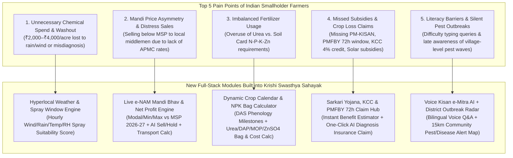
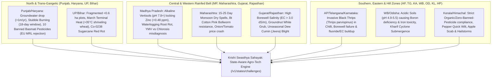

# Indian AgriTech Market Study & Product Engineering Blueprint
## Krishi Swasthya Sahayak (AgriScan AI) — Full-Stack Farmer Ecosystem Expansion

---

## 1. Executive Summary & Indian Agricultural Market Landscape

India supports **~146 million agricultural landholdings**, with **86.1% classified as small and marginal farmers** (owning less than 2 hectares / 5 acres). Smartphone penetration in rural India has crossed **76%**, driven by affordable 4G/5G connectivity and Digital Public Infrastructure (DPI) initiatives such as **AgriStack**, **e-NAM**, **Bhashini**, and **PM-KISAN**.

However, field studies across Madhya Pradesh, Maharashtra, Punjab, Uttar Pradesh, Andhra Pradesh, Telangana, and Karnataka reveal that **standalone disease-scanning apps suffer from seasonal churn** because farmers face interconnected daily challenges across the entire crop value chain—from pre-sowing soil preparation to post-harvest mandi sales.

> [!IMPORTANT]
> **Key Market Insight:** Farmers do not want five separate apps for leaf scanning, weather, mandi prices, fertilizer calculation, and government schemes. The highest-retention AgriTech platforms in India operate as a **Daily Farming Companion ("Kisan Super-App")** combining **AI Crop Diagnostics + Spray Weather Windows + Real-Time Mandi Bhav + Stage-Wise Crop Calendar/NPK Calculator + Sarkari Yojana & Insurance Access + Voice-First Advisory**.

---

## 2. Competitive Benchmark Analysis (Indian AgriTech Ecosystem)

| Platform | Core Strength | Key Features Offered | Critical Gaps / Limitations |
| :--- | :--- | :--- | :--- |
| **Plantix** | AI Vision Pathology | Leaf image disease/pest detection, community forum, basic fertilizer calculator | Weak Indian APMC Mandi price integration, no CIB&RC/state-ban compliance audit, no govt scheme or PMFBY claim linkage |
| **DeHaat** | Full-Stack Input/Output | Mandi linkages, input marketplace, weather alerts, call center support | Heavy dependency on physical franchise centers; complex UI for low-literacy users |
| **AgroStar** | Agri-Input Commerce & Agronomy | "Agri-Doctor" chat, brand input catalog, regional language content | Primarily e-commerce/retail driven; lacks nutrition-first zero-chemical hierarchy |
| **BharatAgri** | Scientific Crop Calendar | Personalized DAS (Days After Sowing) crop advisory, soil test mapping, video calls | Subscription paywalls for core advisory; limited real-time spectral leaf diagnostics |
| **Govt DPI Apps** (*e-NAM, Meghdoot, Kisan Suvidha, Kisan e-Mitra*) | Official Data (Mandi, IMD Weather, PM-KISAN) | Authentic APMC modal prices, block-level IMD weather, PM-KISAN status chatbots | Fragmented across 6+ separate portals/apps with inconsistent UX and no unified farm profile |
| **Krishi Swasthya Sahayak (AgriScan AI)** *(Target State)* | **Unified AI Pathology + Nutrition-First + DPI Super-App** | 4-Stage Multimodal AI Leaf/Video Scan, CIB&RC & State-Ban Compliance, Soil Health Card, **+ Live Mandi Bhav, Spray Weather Window, NPK & Crop Calendar, Sarkari Yojana Hub, Voice Kisan e-Mitra** | Bridges the gap between precision AI plant pathology and daily farm economics in a single offline-capable PWA |

---

## 3. Core Pain Points of Indian Farmers & Feature Mapping

---

## 4. Detailed Specification of Features Being Built

### Module 1: Live APMC / e-NAM Mandi Bhav & AI Market Intelligence (`/v1/market/mandi-prices`)
* **Multi-Mandi Coverage**: Real-time spot prices across key Indian APMCs (Ujjain, Indore, Lasalgaon, Azadpur, Guntur, Khanna, Akola, Kota, Davanagere) for all 10 supported crops.
* **MSP 2026–27 Benchmarking**: Compares live modal prices against Government of India Minimum Support Prices (e.g., Soybean ₹4,892/qtl, Paddy ₹2,300/qtl, Wheat ₹2,425/qtl, Cotton ₹7,521/qtl, Maize ₹2,225/qtl).
* **AI "Sell or Hold" (बेचें या रोकें) Signal**: Analyzes arrival volume (tonnes), 7-day price momentum, and moisture discounts to advise whether to sell immediately or store.
* **Net Mandi Realization Calculator**: Calculates net profit after factoring in distance, tractor/trolley transport cost, and mandi hamali/weighing charges for the farmer's harvest quantity.

### Module 2: Hyperlocal IMD Weather, Spray Window & Irrigation Advisory (`/v1/weather/spray-advisory`)
* **Spray Window Suitability Engine**: Evaluates temperature ($<32^\circ\text{C}$), wind speed ($<12\text{ km/h}$ to prevent chemical drift), relative humidity ($45\%–80\%$), and 6-hour rain probability ($<20\%$) to output an actionable **Spray Status (`SAFE TO SPRAY` / `MODERATE CAUTION` / `DO NOT SPRAY - WASHOUT RISK`)**.
* **Hourly Spray Schedule**: Displays the best morning and evening foliar application windows (critical for Step 1 Foliar Mineral sprays like $\text{ZnSO}_4$).
* **Epidemiological Micro-Climate Risk**: Computes real-time fungal/pest incubation risk (e.g., High Humidity $>78\%$ triggering Soybean Rust / Paddy Blast alerts) and ETc-based irrigation scheduling.

### Module 3: Scientific Crop Calendar & Soil-Linked NPK Fertilizer Calculator (`/v1/advisory/crop-calendar`, `/v1/advisory/fertilizer-calculator`)
* **Stage-Wise Crop Calendar (Sowing to Harvest)**: Tracks the farmer's active crop from Basal/Sowing (0 DAS) $\rightarrow$ Crown Root/Seedling (15–25 DAS) $\rightarrow$ Vegetative/Branching (30–45 DAS) $\rightarrow$ Flowering/Reproductive (50–70 DAS) $\rightarrow$ Pod/Grain Filling & Harvest (80–110 DAS) with localized checklists.
* **Precision NPK + Micronutrient Bag Calculator**: Converts Soil Health Card readings ($\text{N}, \text{P}, \text{K}, \text{Zn}, \text{pH}$) and acreage into exact commercial fertilizer bags (**Neem-Coated Urea 45kg**, **DAP 50kg / SSP 50kg**, **MOP 50kg**, **Zinc Sulphate 21%**, and **Bio-NPK/ZSB**), comparing chemical vs. integrated nutrient management (INM) costs.

### Module 4: Sarkari Yojana, KCC Limit Calculator & PMFBY 72-Hour Claim Intimation (`/v1/schemes/eligibility`, `/v1/schemes/claim`)
* **Personalized Scheme Eligibility & Benefit Calculator**:
  * **PM-KISAN Samman Nidhi**: ₹6,000/year DBT status & installment tracker.
  * **PMFBY (Pradhan Mantri Fasal Bima Yojana)**: 1.5%–2% premium calculator + **72-Hour Crop Damage Intimation** directly attaching the farmer's AI Diagnosis Report & GPS coordinates.
  * **PM-KUSUM Solar Pump Subsidy**: 60% Central+State subsidy calculator for 3HP–7.5HP solar pumps.
  * **PM-RKVY / Per Drop More Crop (Micro-Irrigation)**: 55%–80% drip/sprinkler subsidy for small/marginal farmers.
  * **Kisan Credit Card (KCC) Scale-of-Finance Estimator**: Computes eligible credit limit at 4% effective interest rate based on crop and acreage.

### Module 5: "Kisan e-Mitra" Voice AI Assistant & Hyperlocal Outbreak Radar (`/v1/assistant/ask`, `/v1/community/outbreaks`)
* **Conversational Voice & Text Assistant**: Farmers can speak in Hindi or English (via Web Speech API microphone or quick voice chips) and receive instant spoken + visual answers grounded in live Mandi prices, CIB&RC rules, Soil Card data, weather windows, and government schemes.
* **15km Tehsil Outbreak Radar**: Crowdsourced & KVK-verified real-time pest/disease alerts in nearby villages so farmers can apply preventive Step 1 nutritional cuticle-hardening sprays before the outbreak reaches their field.

---

## 5. State-Wise Challenges of Indian Farmers & How Technology Resolves Them

Indian agriculture is not monolithic—a farmer in **Bathinda (Punjab)** faces completely different agro-ecological, regulatory, and market crises than a farmer in **Ujjain (Madhya Pradesh)**, **Akola (Maharashtra)**, or **Guntur (Andhra Pradesh)**. Below is our comprehensive **State-Wise Farmer Challenge & Technology Resolution Matrix**:

### Detailed State-by-State Matrix (Challenges $\rightarrow$ Technology Solutions $\rightarrow$ Economic Impact)

| State / Agro-Zone | Dominant Crops | Core Farmer Challenges (Soil, Water, Pest, Market) | How Technology Resolves the Challenge (Implemented in App) | Quantified Farmer Impact (ROI) |
| :--- | :--- | :--- | :--- | :--- |
| **1. Madhya Pradesh** *(Malwa & Nimar Black Cotton Vertisol Belt)* | Soybean (`JS 20-34`), Sharbati Wheat, Gram (Chana), Garlic, Maize | • **Alkaline Soil Zinc Lock**: High pH ($7.6–8.2$) in deep black clay fixes soil-applied Zinc ($\text{Zn} < 0.45\text{ ppm}$), causing leaf yellowing (*chlorosis*). • **YMV Misdiagnosis**: Dealers misdiagnose Zinc chlorosis as Yellow Mosaic Virus (YMV) and sell ₹2,200/acre toxic insecticides. • **Monsoon Waterlogging**: Poor drainage in flat black clay causes *Rhizoctonia* / Charcoal Root Rot. | 1. **AI Chlorosis vs. YMV Differentiator**: Separates symmetrical interveinal Zinc deficiency from asymmetrical YMV mosaic. 2. **pH-Triggered Chelated Foliar Protocol**: Automatically switches from soil $\text{ZnSO}_4$ to foliar **Chelated $\text{Zn-EDTA}$ (12%) + ZSB Bio-Fertilizer** when $\text{pH} \ge 7.5$. 3. **Broad-Bed Furrow (BBF) Planter CHC Booking**: Books BBF tractor planter to drain excess rain & save 25% seed. | **₹3,450/acre** saved (eliminates unnecessary pesticide + +2.5 qtl/acre yield) |
| **2. Punjab & Haryana** *(Trans-Gangetic Irrigated Food Bowl)* | Paddy (`PR-126` / Basmati `1121`), Wheat (`HD-3086`), Mustard, Potato | • **Groundwater Depletion**: $78\%$ blocks over-exploited ($>1\text{m/yr}$ water table drop from puddled paddy). • **Parali (Stubble) Crisis**: Only 15–20 days between paddy harvest and wheat sowing. • **Basmati Export MRL Rejections**: State ban on **10 pesticides** (*Tricyclazole, Buprofezin, Acephate, Chlorpyrifos, Propiconazole, Thiamethoxam, Profenofos, Carbendazim, Triazophos, Methomyl*). • **Skewed NPK Ratio**: Urea overuse ($31:8:1$ vs ideal $4:2:1$). | 1. **CIB&RC Punjab 10-Molecule Auto-Blocker**: Blocks all 10 banned Basmati molecules and prescribes MRL-safe *Trichoderma* + *Pseudomonas* + Neem Azadirachtin. 2. **Happy Seeder / Super SMS & Pusa Decomposer CHC Booking**: Matches farmers with village Custom Hiring Centers (CHC) & calculates Carbon Credit incentives. 3. **DSR (Direct Seeded Rice) & AWD Advisory**: Unlocks ₹1,500/acre state DSR incentive & saves 35% groundwater. | **₹4,800/acre** benefit (export premium + DSR incentive + 1.5 bags Urea saved) |
| **3. Maharashtra** *(Vidarbha, Marathwada & Khandesh Belt)* | Bt Cotton, Soybean, Tur (Pigeonpea), Banana (`G-9`), Onion, Sugarcane | • **Mid-Monsoon Dry Spells**: 15–25 day rain gaps during flowering cause 40% boll/flower shedding. • **Pink Bollworm (PBW) Resistance**: *Pectinophora gossypiella* resistance in Bt Cotton after 60 DAS. • **Extreme TOP (Tomato-Onion-Potato) Price Volatility**: Sudden mandi gluts and distress sales. | 1. **Dry-Spell Osmoprotectant Alert**: Triggers foliar **Potassium Nitrate ($\text{13:00:45}$) @ 10g/L + Kaolin/Silicate** anti-transpirant during $>10$-day rain gaps to lock leaf moisture. 2. **Gossyplure Pheromone ETL Counter**: Tracks moth catches ($>8\text{ moths/trap}$) & triggers PBW mating disruption + Neem 10000 ppm. 3. **e-NAM Cold-Storage / Kisan Rail Net Profit Calculator**. | **₹5,200/acre** protected against boll shedding & PBW boll rot |
| **4. Uttar Pradesh & Bihar** *(Gangetic Alluvial Plains)* | Wheat, Paddy, Sugarcane (`Co-0238`), Potato, Maize, Mango | • **March Terminal Heat Wave**: Sudden $>35^\circ\text{C}$ spike in March shrivels wheat grain by 15–20%. • **Sugarcane Red Rot ("Cancer of Cane")**: Widespread breakdown of `Co-0238` variety across UP. • **Small Fragmented Plots ($<0.6\text{ ha}$)** & high diesel pumping costs (₹220/hr). | 1. **Terminal Heat-Shield Alert**: Triggers **$\text{00:52:34}$ (Mono Potassium Phosphate) @ 10g/L + Salicylic Acid** foliar spray 48 hours before predicted March heat spikes. 2. **Sugarcane Red-Rot Bio-Sett Protocol**: *Trichoderma harzianum* sett treatment + varietal replacement planner (`Co-0118` / `CoLk-14201`). 3. **PM-KUSUM Solar / Shared Kisan Drone CHC Booking** for marginal plots. | **₹3,900/acre** saved via heat-stress grain weight protection & solar irrigation |
| **5. Andhra Pradesh, Telangana & Karnataka** *(Southern Deccan & Chilli/Horticulture Belt)* | Red Chilli (`Teja`), Tomato, Paddy, Cotton, Maize, Coffee/Turmeric | • **Invasive Black Thrips (*Thrips parvispinus*)**: Up to 60% flower drop and leaf curl in Guntur/Khammam/Byadgi chilli; heavy chemical sprays fail and breach export MRLs. • **Borewell Failure & Salinity**: High water EC ($>2.5\text{ dS/m}$) and fluoride scorching root tips. | 1. **Black Thrips Bio-Rational IPM Stack**: Blue + Yellow Sticky Traps (25/acre) + entomopathogenic ***Beauveria bassiana* & *Lecanicillium lecanii*** + Potassium Silicate cuticle armor. 2. **Saline Borewell EC Fertigation Neutralizer**: Replaces chloride-heavy MOP with **Sulfate of Potash ($\text{00:00:50}$)** & Gypsum bed conditioning. | **₹7,500/acre** saved in high-value Chilli/Tomato pesticide costs & export quality |
| **6. Gujarat & Rajasthan** *(Arid & Semi-Arid Oilseed & Spice Belt)* | Groundnut, Cumin (*Jeera*), Mustard, Cotton, Castor, Bajra | • **Groundnut White Grub (*Holotrichia*) & Stem Rot**: Root destruction in sandy-loam soils. • **Cumin (*Jeera*) Alternaria Blight**: Overnight crop loss when unseasonal winter dew/cloud cover exceeds 80% RH. • **Severe Aridity & High Groundwater EC**. | 1. **48-Hour Dew & Cloud Blight Radar**: Alerts Cumin/Mustard farmers before dew point spikes to spray preventive Potassium Phosphonate + *Pseudomonas*. 2. **White Grub Root-Zone Bio-Drench**: ***Metarhizium anisopliae*** + Neem Cake basal application. 3. **PMKSY 75%–80% Drip Subsidy & Fertigation Scheduler**. | **₹6,100/acre** protected in Cumin/Groundnut yield & 45% water saved |
| **7. West Bengal, Odisha & Assam** *(Eastern Alluvial & Coastal High-Rainfall Belt)* | Aman/Boro Paddy, Potato (`Kufri Jyoti`), Jute, Vegetables, Tea | • **Strongly Acidic Soils ($\text{pH } 4.8–5.5$)**: Causes acute Boron/Molybdenum deficiency, Phosphorus fixation, and Iron toxicity (*bronzing*) in lowland paddy. • **Cyclone / Flash-Flood Submergence** & Hooghly **Potato Late Blight (*Phytophthora*)**. | 1. **Acid-Soil Dolomite Lime & Solubor Calculator**: Prescribes paper-mill sludge / Dolomite lime ($200\text{ kg/acre}$) + foliar **Boron 20% ($1.5\text{ g/L}$)**. 2. **Late Blight Fog Warning & Submergence Seed Advisory** (*Swarna-Sub1* / *CR Dhan 801*). | **₹4,100/acre** saved by preventing Potato Late Blight & correcting soil acidity |
| **8. Kerala & Himachal Pradesh** *(Spices, Plantation & Hill Horticulture)* | Black Pepper, Cardamom, Banana, Coconut, Apple, Off-Season Veg | • **Strict State Chemical Bans (Kerala)**: Ban on Endosulfan, Glyphosate, Carbofuran, Chlorpyrifos; high rainfall causes **Pepper Phytophthora Quick Wilt**. • **Apple Scab, Premature Leaf Fall & Hailstorms** in Himachal Pradesh. | 1. **Kerala Organic-First CIB&RC Guardrail**: Enforces 100% bio-compliant **IIHR *Trichoderma* Bio-Capsules + *Pseudomonas fluorescens* + Bordeaux 1% paste**. 2. **Himachal Anti-Hail Net Subsidy & Mills-Table Scab Predictor**: Predicts leaf-wetness scab hours & books 80% subsidized Anti-Hail Nets. | **₹8,200/acre** protected in high-value Apple/Pepper plantations |

---

## 6. Module 6 Implementation: State-Wise Agro-Climatic Challenge & Tech Intervention Engine

To turn this state-wise research into an actionable tool for farmers, extension workers, and FPOs, we have implemented **Module 6 (`viewStateMatrix`)**:
1. **SQLite Tables (`schema.sql`)**:
   * `state_agro_challenges` (Table 17): Stores the 8 state agro-climatic profiles, soil pH/EC/nutrient bottlenecks, state-banned pesticides, AI/IoT/Bio tech interventions, and per-acre ROI.
   * `chc_machinery_bookings` (Table 18): Stores farmer bookings for state-specific technological interventions (**Kisan Drone Foliar Spray**, **Happy Seeder / Pusa Bio-Decomposer**, **Broad-Bed Furrow BBF Planter**, **Bio-Rational Black Thrips Kit**, **Solar Pump / Drip Kit**).
2. **REST APIs (`apiRoutes.ts` & `farmerEcosystemService.ts`)**:
   * `GET /v1/states/challenges?state=MP`: Returns the complete state-wise challenge matrix, state pesticide ban rules, technology resolution steps, and active CHC/Drone bookings.
   * `POST /v1/states/tech-intervention-book`: Books a subsidized CHC machine, Kisan Drone spray, or state-specific bio-input kit directly into SQLite.
3. **Interactive Mobile UI (`web_simulator/index.html` & `app.js`)**:
   * Accessible from the **Home Dashboard ("राज्य-वार कृषि समाधान एवं ड्रोन/CHC")** with state selector chips, Soil/Water/Pest challenge cards, CIB&RC State Ban alerts, Technology Resolution steps, and 1-click **Kisan Drone / CHC Tech Booking**.
